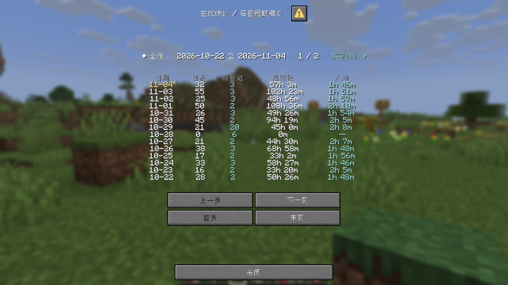
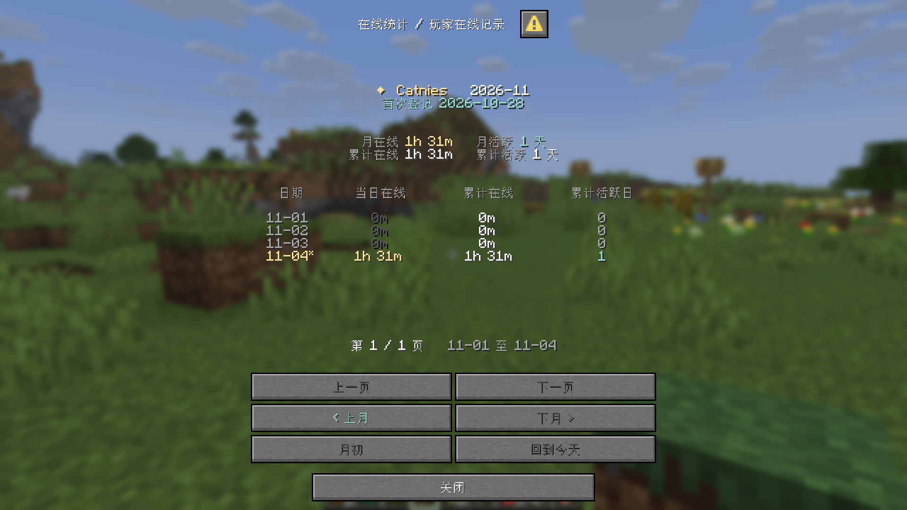

Module `online_time` · Configuration `features/online_time.yml`

Track daily playtime, daily active players, new registrations and retention. AFK time counts. Timing starts when a player enters the game and continues until disconnection. Time before collection began is not recovered. New players are identified by their first Sparrow profile registration, not by the date this module was enabled.

## Commands and permission

All report commands are in-game only and use `sparrow.command.online_time.report` by default.

| Command | Purpose |
| --- | --- |
| `/online-time` | Open the daily activity overview. |
| `/online-time new [date]` | List players registered on a date; defaults to today. Use `YYYY-MM-DD`. |
| `/online-time retention` | Open exact-day new-player retention. |
| `/online-time player <player>` | Open the player's records for the current month. |
| `/online-time calendar <player> [month]` | Open the same records page, optionally for `YYYY-MM`. |

Examples: `/online-time new 2026-11-01` and `/online-time calendar Catnies 2026-10`. Player names can refer to offline players with existing profiles. Dates and months cannot be in the future. The command configuration key is `online_time_report`.

## Statistics time zone

```yaml
time-zone: Asia/Shanghai
```

New configurations use `Asia/Shanghai`. Omit the setting or leave it blank to use the system time zone. Restart the server after changing it. Participating network servers should use the same time zone.

Days follow calendar dates in this zone. Weeks start on Monday; months start on the first day. Sessions spanning midnight or a month boundary, including AFK sessions, are divided between their respective dates without requiring a reconnect. Changing the zone does not redistribute previously recorded daily totals.

## Daily activity overview



Each page shows 14 dates, newest first. Use previous, next, first and last page buttons.

| Column | Definition |
| --- | --- |
| Active players | Distinct players with positive online time that day. |
| Registrations | Players first registered that day, independently of whether they have recorded playtime. |
| Total time | Combined online time for all players that day. |
| Average | Total time divided by active players; `—` when nobody was active. |

Click a registration count to open that day's new-player list. The retention link in the header opens the retention report. Reports show saved records: additional online time is normally saved every minute and on departure, rather than refreshed every second. Today's provisional data is marked `*`.

## New-player list

Columns show player name, registration time, first-day playtime and active days. First-day time covers only the registration date. Active days count dates with positive online time within the reporting range and need not be consecutive.

Use previous, next, first and last page buttons to browse players, and the previous-day and next-day buttons to change registration dates. Click a player name to open their records. When following a link between reports, the back button returns to the source page.

## Player online records



`player` and `calendar` open the same page. The header shows first registration, online time and active days for the selected month, plus cumulative online time and active days.

The daily table shows eight dates per page in ascending order. Daily time covers that date. Cumulative time and active days run from the beginning of available records through the row's date, rather than only the current page or month. Dates with no playtime are also listed; today is marked `*`.

Previous and next page browse within the month. Previous and next month open the first page of the target month. Month-start and today buttons provide shortcuts. Future dates are not shown.

## Exact-day retention

Each page shows 14 registration dates, with D1, D2, D3, D4, D5, D7 and D14 columns. Registration day is D0.

**DN = players in the registration cohort with online time on the Nth calendar day after registration / all players in that cohort.**

For example, if 100 players registered on November 1 and 20 were active on November 8, D7 is 20%. Only the specified date counts. Consecutive activity is not required, and missing dates between visits are not treated as retained. D3 can therefore exceed D2.

Percentages are colored by value. Hover to see the observation date and counts. Observations for today carry `*`. Future dates, dates not fully covered by collection, and empty cohorts display `—` with an explanation on hover. The page total weights each column by eligible cohort sizes, excludes observations still in progress today, and does not simply average percentages. Click a registration date to open its new-player list.

## PlaceholderAPI

Install PlaceholderAPI to use these placeholders; no separate expansion download is required.

| Period | Readable duration | Whole seconds |
| --- | --- | --- |
| Today | `%sparrowtime_today%` | `%sparrowtime_today_seconds%` |
| This week | `%sparrowtime_week%` | `%sparrowtime_week_seconds%` |
| This month | `%sparrowtime_month%` | `%sparrowtime_month_seconds%` |
| All time | `%sparrowtime_total%` | `%sparrowtime_total_seconds%` |

In Sparrow text, use MiniMessage tags such as `<papi:sparrowtime_today>`. The target player is supplied by the plugin requesting the placeholder.

For players online on this server, values include time not yet saved. The first offline lookup waits for records and may briefly delay the result. Values for players online on another server are not guaranteed to update live: continuous queries may keep showing an earlier value until the player joins or leaves. Do not use this as a live cross-server timer. Disabled collection or a player whose records are not ready may produce empty text.